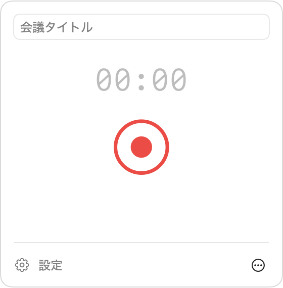
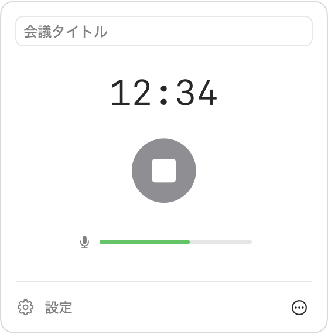
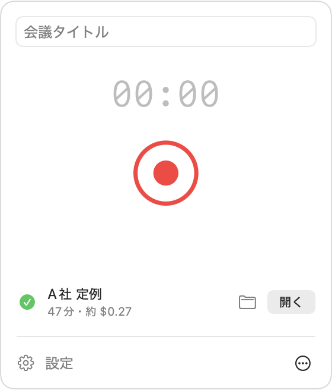

# MeetNote

会議を録音して、議事録を自動で作る macOS のメニューバーアプリです。

録音ボタンを押して会議を始め、終わったら止めるだけです。数分後には、要約・決定事項・ToDo と、話者ごとの発言の全文が入った議事録が Mac の中にできています。

| 録音前 | 録音中 | できあがり |
|:---:|:---:|:---:|
|  |  |  |

## できること

- **ボタン1つで議事録まで：** 録音を止めると、文字起こしと議事録の作成が自動で進み、終わると通知が出ます。
- **対面の会議：** Mac のマイクで、その場の全員の声を録音します。
- **オンライン会議：** Zoom・Google Meet・Teams などで、Mac から出る相手の声も一緒に録音できます。会議にボットを参加させる必要はありません。
- **誰が話したかを区別：** 声の特徴から話者を聞き分けて、「話者A」「話者B」と分けた発言録を作ります。
- **議事録の形式を変えられる：** 要約・議論の内容・決定事項・ToDo・論点・次回までの確認事項、という形式が初期設定です。設定画面で指示文を書き換えれば、好きな形式にできます。
- **録音が消えにくい：** 録音中にアプリが落ちても、そこまでの音声は残ります。あとから議事録にできます。
- **既存の音声ファイルにも対応：** スマホのボイスレコーダーで録った音声（m4a / mp3 / wav / mp4）からも作れます。
- **保存は自分の Mac の中：** 会議ごとのフォルダに「議事録.md」と「音声.m4a」の2つだけができます。アカウント登録やクラウドへの保存はありません。

できあがる議事録は、次のような形です（内容は例です）。

```markdown
# A社 定例
- 日時：2026年11月21日（土） 10:30
- 参加者：話者A、話者B、話者C

## 要約
- 新プランの価格を月額3,000円にすることで合意した。
- 公開日は12月15日を目標とし、来週の定例で最終判断する。

## 議論の内容
### 新プランの価格
- 話者A：競合が月額2,800〜3,500円なので、3,000円が妥当だと提案した。
- 話者B：年払いの割引を付けたいと述べた。割引率は未定。

## 決定事項
- 新プランの価格は月額3,000円とする。

## ToDo
| 担当 | 内容 | 期限 |
|---|---|---|
| 話者B | 年払いの割引率の案を作る | 来週の定例まで |

---

## 発言録

[00:00:12] 話者A：では始めます。まず新プランの価格についてですが、…
```

## 仕組みと費用

文字起こしは [ElevenLabs](https://elevenlabs.io/) の Speech to Text、議事録の作成は [Anthropic](https://www.anthropic.com/) の Claude を使います。それぞれの API キーを自分で用意して、アプリに設定します。

月額料金はなく、使った分だけ各社に支払います。文字起こしは音声1時間あたり $0.20（2026年11月時点、ElevenLabs の無料枠・プランに含まれる時間を超えた分）で、これに Claude の利用料が加わります。Claude の利用料は、選ぶモデルと会議の長さで変わります。正確な金額は各社の管理画面で確認してください。

音声は ElevenLabs に、文字起こしの文章は Anthropic に送られます。詳しくは「[外部に送られるデータ](#外部に送られるデータ)」を読んでください。

## できないこと

- 話している最中の文字起こし（リアルタイム字幕）。会議が終わってから処理します。
- 話者への名前の割り当て。発言録は「話者A」「話者B」のままです。
- iPhone・iPad・Windows での利用。
- ビルド済みアプリの配布。自分の Mac でビルドして使います。

個人用に作ったものを、そのまま公開しています。[PLAN.md](PLAN.md) は開発を始めたときの計画書で、保存するファイルの構成などは、作りながら変えた部分があります。現在の仕様はこの README が正です。

## 必要なもの

- macOS 15 以降、Xcode 26、[XcodeGen](https://github.com/yonaskolb/XcodeGen)（`brew install xcodegen`）
- ElevenLabs の APIキー（Speech to Text）
- Anthropic の APIキー

ffmpeg は不要です（音声の変換は AVFoundation で行います）。

## ビルド

```sh
./scripts/setup-signing.sh    # 最初に1回だけ。このMac専用の署名用証明書を作る
./scripts/build.sh            # build/Build/Products/Release/MeetNote.app を作る
./scripts/build.sh --install  # 作ったあと /Applications（アプリケーション）にコピーする
```

`setup-signing.sh` は省略できますが、実行しておくことをおすすめします。証明書なしでビルドすると、ビルドし直すたびに macOS が別のアプリと見なし、マイクや画面収録の許可を毎回求められます。実行中に Mac のパスワードを求める確認が出ます。作られる証明書「MeetNote Local Signing」はログインキーチェーンに入り、このMacでの署名にだけ使われます。不要になったら「キーチェーンアクセス」から削除できます。

テストは次のコマンドで実行できます。

```sh
xcodegen generate
xcodebuild -project MeetNote.xcodeproj -scheme MeetNote -derivedDataPath build test
```

`MeetNote.xcodeproj` は `project.yml` から生成されるので、Git には入れていません。

## 使い方

1. `MeetNote.app` を起動すると、メニューバーに波形のアイコンが出て、同じ操作画面のウインドウも開きます。
2. 操作画面の左下の「設定」で、ElevenLabs と Anthropic の APIキーを入力して「保存」を押します。
3. 必要なら会議タイトルを入力し、赤い丸（●）の録音ボタンを押します。ショートカット ⌃⌥⌘R でも開始／停止できます。
4. 録音中はメニューバーに経過時間が出ます。ボタンの下のレベル表示が動いていれば、音が入っています。
5. 会議が終わったら停止ボタン（■）を押します。「変換中 → 文字起こし中 → 議事録作成中」と進みます。
6. 終わると通知が出ます。通知をクリックすると議事録が開きます。

タイトルは録音中に入力しても間に合います（停止した時点の内容を使います）。

### メニューバーのアイコンが見えないとき

メニューバーのアイコンが多いと、MeetNote のアイコンが画面上部の切り欠き（ノッチ）の裏に隠れることがあります。そのときは次のどれかで操作できます。

- Spotlight やアプリケーションフォルダから MeetNote をもう一度開く。操作画面のウインドウが出ます。ウインドウを閉じてもアプリは終了しません。
- ショートカット ⌃⌥⌘R で録音を開始／停止する。
- ⌘ を押しながらメニューバーのアイコンをドラッグして、MeetNote を右側（時計の近く）に移す。

### 対面の会議とオンライン会議

| 会議 | 「Macの音も録音する」 | 録音されるもの | 必要な許可 |
|---|---|---|---|
| 対面 | オフ（初期値） | マイクに入る全員の声 | マイク |
| オンライン（Zoom・Meet・Teams） | オン | マイク（自分）と、Macから出る音（相手）を別々に | マイク、画面収録とシステムオーディオ録音 |

誰が話したかは、どちらの場合も文字起こし（ElevenLabs）が声の特徴から聞き分けて「話者A」「話者B」と分けます。

対面の会議では、Macを参加者全員の声が届く位置に置いてください。離れた人の声は聞き取りの精度が落ちます。外付けのマイクを使う場合は、macOS のシステム設定 →「サウンド」→「入力」で選んだマイクが使われます。

「Macの音も録音する」は、右下の「…」メニューで切り替えます。オンにして初めて録音するとき、macOS が「画面収録とシステムオーディオ録音」の許可を求めます。画面の映像は保存も送信もしていません。許可したあとは、アプリを一度終了して起動し直してください。

### 録音が残る仕組み

録音中の音声は `~/Library/Application Support/MeetNote/Recordings/` に書き足していきます。録音中にアプリが落ちても、そこまでの音声は残ります。APIキーが未設定のまま録音を止めた場合も同じです。「未処理の録音」として表示されるので、「議事録を作る」を押すか、ゴミ箱のボタンで捨ててください（Finder のゴミ箱から戻せます）。

### 既存の音声ファイルから作る

対面の会議をスマホで録った場合などは、右下の「…」メニューの「音声ファイルから作る…」で選ぶか、ウィンドウにファイルをドロップします。対応形式は m4a / mp3 / wav / mp4 です（mp4 は音声だけを使います）。複数まとめて入れると、1件ずつ順番に処理します。

### 保存されるファイル

1回の会議につきフォルダが1つでき、中身は議事録と音声の2つだけです。初期設定の保存先は `~/Documents/MeetNote/` です（設定で変更できます）。

```
~/Documents/MeetNote/
  ├─ 2026-11-21_1030_会議タイトル/
  │    ├─ 議事録.md
  │    └─ 音声.m4a
  └─ 2026-11-25_1400/
       ├─ 議事録.md
       └─ 音声.m4a
```

- **議事録.md：** 前半が議事録（要約・議論の内容・決定事項・ToDo など）、後半の「発言録」が話者ごとの発言の全文です。
- **音声.m4a：** 圧縮した録音です（モノラル・16kHz・32kbps、1時間あたり約14MB）。「Macの音も録音する」がオンのときは、マイクと Mac の音を混ぜたものです。

フォルダ名の日時は、録音を始めた日時です。ファイルから作った場合は、そのファイルの作成日時です。これ以外のデータ（文字起こしの生データなど）は残しません。フォルダは、議事録ができあがった時点で作られます。

### 失敗したとき

通信エラーや混雑（HTTP 429・5xx）は、最大2回まで自動で再試行します。それでも失敗した場合は通知が出て、音声は作業用フォルダ（`~/Library/Application Support/MeetNote/Work/`）に残ります。画面の「残っている音声を表示」から開けるので、「…」メニューの「音声ファイルから作る…」でやり直せます。APIキーの誤り（401）などは再試行しません。

### 設定

| 項目 | 内容 |
|---|---|
| APIキー | このMacの中のファイルに保存します。設定画面には読み出しません |
| 保存先 | 議事録のファイルを置く場所 |
| 議事録のモデル | 初期値は `claude-sonnet-5-5`。一覧にないモデルIDも入力できます |
| 文字起こしのモデル | 初期値は `scribe_v3` |
| プロンプト | 議事録の形式とルール。「プロンプト」タブで編集できます |
| 概算コストの単価 | `~/Library/Application Support/MeetNote/pricing.json` を編集します |

`pricing.json` は初回の処理時か、設定画面の「pricing.json を表示」を押したときに作られます。概算コストは、処理が終わった直後に画面へ表示されます。単価が載っていないモデルを使った場合は表示されません。正確な金額は、各社の管理画面で確認してください。

### コマンドラインから実行する

動作確認用に、画面を出さずに1件だけ処理できます。

```sh
MeetNote.app/Contents/MacOS/MeetNote --process 会議.m4a --title "A社 定例"
```

APIキーは保存済みのファイルから読みます。環境変数 `ELEVENLABS_API_KEY` と `ANTHROPIC_API_KEY` があれば、そちらを優先します。

## 知っておくこと

- **APIキーの保存場所：** `~/Library/Application Support/MeetNote/keys.json` に、本人だけが読める権限（600）で保存します。暗号化はしていないので、同じユーザーで動くほかのプログラムからは読めます。キーチェーンを使っていないのは、Apple 発行の証明書で署名していないアプリだと、ビルドし直すたびにパスワードを求められるためです。ElevenLabs のキーは Speech to Text だけに権限を絞っておくことをおすすめします。
- **オンライン会議をスピーカーで聞いている場合：** 相手の声がマイクにも入るため、`mic.m4a` に相手の声が混ざります。議事録には影響しませんが、イヤホンを使うときれいに分かれます。
- **話者の名前：** 発言録の話者は「話者A」「話者B」と表示されます。実際の名前を割り当てる機能はまだありません。
- **長い会議：** ElevenLabs の上限（15時間・5GB）を超える音声は、14時間ごとに分けて送ります。分けた場合、話者ラベルは区間ごとに振り直されるため「1-A」「2-A」のように区間番号が付きます。
- **概算コスト：** ElevenLabs はプランに含まれる時間を使い切ったあとの単価（1時間あたり $0.20）で計算しています。プランの範囲内であれば、実際の追加請求はありません。

## 外部に送られるデータ

音声は ElevenLabs に、文字起こしの文章は Anthropic に送られます（2026年11月時点で確認した内容です）。

**ElevenLabs**

- プライバシーポリシー上、送ったデータはモデルの学習に使われることがあります。**使われないようにするには、ElevenLabs のサイトでアカウントの「Terms and Privacy」→「Data use」からオプトアウトしてください。** オプトアウトは、設定した後に送るデータにだけ効きます。
- 送ったデータを保存させない「Zero Retention Mode」は Enterprise 契約だけの機能で、このアプリでは使っていません。

**Anthropic**

- API で送ったデータは、初期設定のままでモデルの学習に使われません。特別な設定は不要です。

会議を録音・処理するときは、相手に一言断ってください。

## コードの構成

```
MeetNote/
  App/       起動、メニューバーの状態管理、通知
  Core/      設定、APIキーの保存、単価、共通のエラー処理
  Services/  録音、音声変換、文字起こし、Claude 連携、処理全体の流れ（Pipeline）
  Views/     メニューバーのウィンドウ、設定画面
MeetNoteTests/
```

文字起こしは `TranscriptionProvider` プロトコルで差し替えられます（`Services/Transcription.swift`）。今は ElevenLabs だけを実装しています。

## ライセンス

[MIT License](LICENSE) です。自由に使う・改変する・再配布することができます。無保証です。
